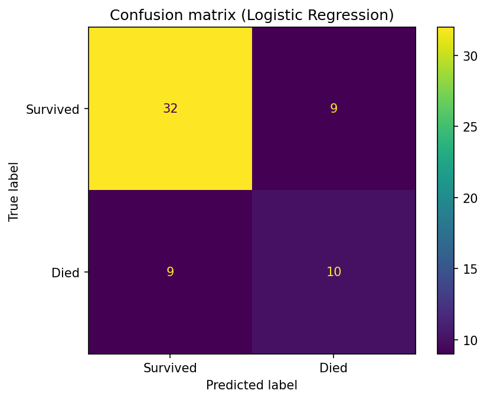
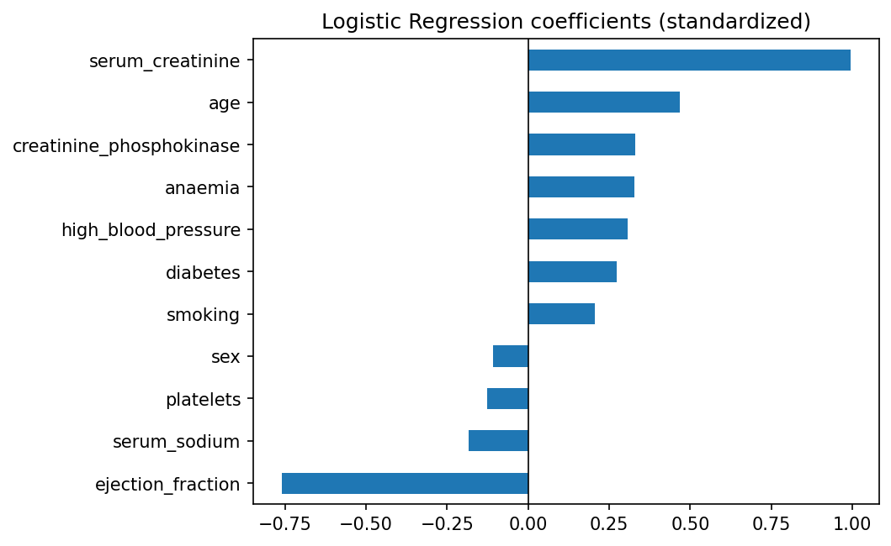

# Heart Failure Analysis

Exploratory analysis of clinical records from 299 heart failure patients, to understand which factors are associated with death during follow-up.

## Research question
Which clinical factors are associated with mortality in heart failure patients?

## Dataset
Heart Failure Clinical Records (UCI Machine Learning Repository): 299 patients, 13 clinical variables, no missing values. About 32% of patients died during follow-up (96 deaths, 203 survivors).

## First findings

### Ejection fraction
Patients who died have a lower ejection fraction (median around 30%) than survivors (median around 38%). A heart that pumps less blood is associated with a higher risk of death.

   

### Serum creatinine
Survivors have values tightly grouped around 1.1 mg/dL, while patients who died show a higher median and more extreme values. Higher creatinine, a sign of kidney stress, is associated with worse outcomes.

> These results show associations, not causal relationships.

## Project structure
- `data/`: the dataset
- `notebooks/`: the exploratory analysis
- `images/`: charts used in this README

## Next steps
- [ ] Explore more variables (age, anaemia, blood pressure...)
- [ ] Build a simple prediction model
- [ ] Evaluate the model and discuss its limits

## Tools
Python, pandas, matplotlib, seaborn
## Modeling

`time` (follow-up duration) was excluded from the inputs, since it would not be known when a patient arrives. Data was split 80/20 (stratified), and models were compared with 5-fold cross-validation on the training set only. The test set was used once, for the final model.

| Model (cross-validation) | AUC | Recall (deaths) | Accuracy |
|---|---|---|---|
| Logistic Regression | 0.80 | 0.75 | 0.76 |
| Random Forest (balanced) | 0.77 | 0.42 | 0.74 |
| Gradient Boosting | 0.71 | 0.48 | 0.69 |

Logistic Regression was selected: best cross-validated performance, and the easiest to interpret.

### Results on the test set (60 patients, 19 deaths)
Accuracy 0.70, AUC 0.73, recall on deaths 0.53, precision on deaths 0.53. The model caught 10 of 19 deaths, with 9 false alarms.

### What drives the predictions
Higher serum creatinine and older age are associated with higher risk; higher ejection fraction is associated with lower risk. This is consistent with the exploratory analysis.

## Limitations
- Small dataset (299 patients): results vary with the train/test split, and the test set contains only 19 deaths.
- Test performance (recall 0.53) was lower than the cross-validation estimate (0.75), showing how unstable estimates are at this sample size.
- The model is not accurate enough for clinical use. It is an exploratory study of associations, not causal relationships.

## Possible improvements
- Repeated cross-validation or a larger dataset for more stable estimates
- Threshold tuning to favor recall
- Calibration and external validation
