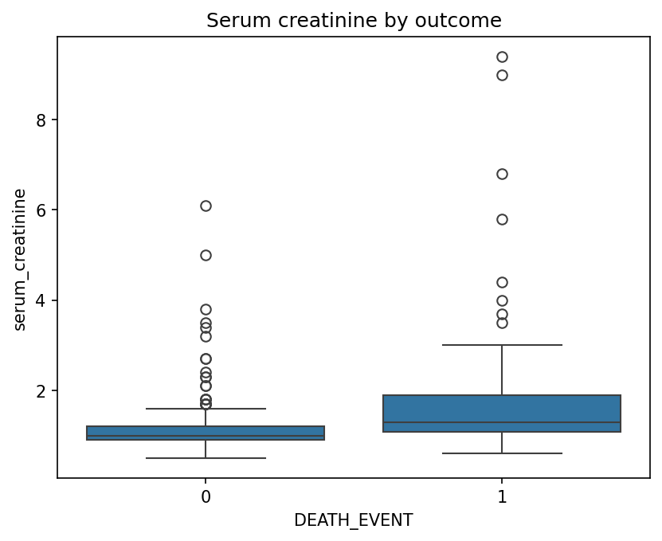

# Heart Failure Analysis

Exploratory analysis of clinical records from 299 heart failure patients, to understand which factors are associated with death during follow-up.

## Research question
Which clinical factors are associated with mortality in heart failure patients?

## Dataset
Heart Failure Clinical Records (UCI Machine Learning Repository): 299 patients, 13 clinical variables, no missing values. About 32% of patients died during follow-up (96 deaths, 203 survivors).

## First findings

### Ejection fraction
Patients who died have a lower ejection fraction (median around 30%) than survivors (median around 38%). A heart that pumps less blood is associated with a higher risk of death.

### Serum creatinine
Survivors have values tightly grouped around 1.1 mg/dL, while patients who died show a higher median and more extreme values. Higher creatinine, a sign of kidney stress, is associated with worse outcomes.

> These results show associations, not causal relationships.

## Project structure
- `data/`: the dataset
- `notebooks/`: the exploratory analysis
- `images/`: charts used in this README

## Next steps
- [ ] Explore more variables (age, anaemia, blood pressure...)
- [ ] Build a simple prediction model
- [ ] Evaluate the model and discuss its limits

## Tools
Python, pandas, matplotlib, seaborn
